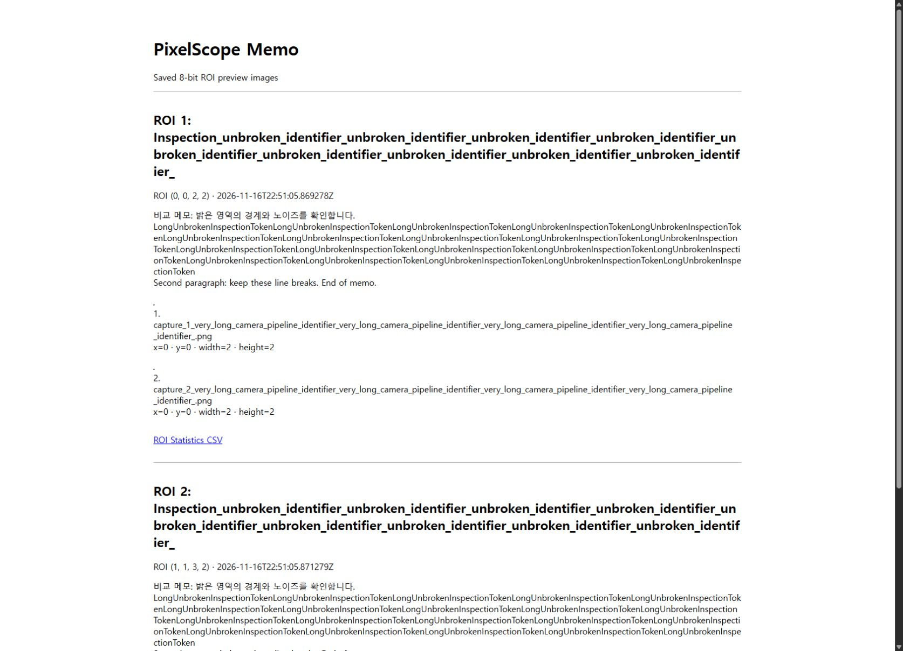
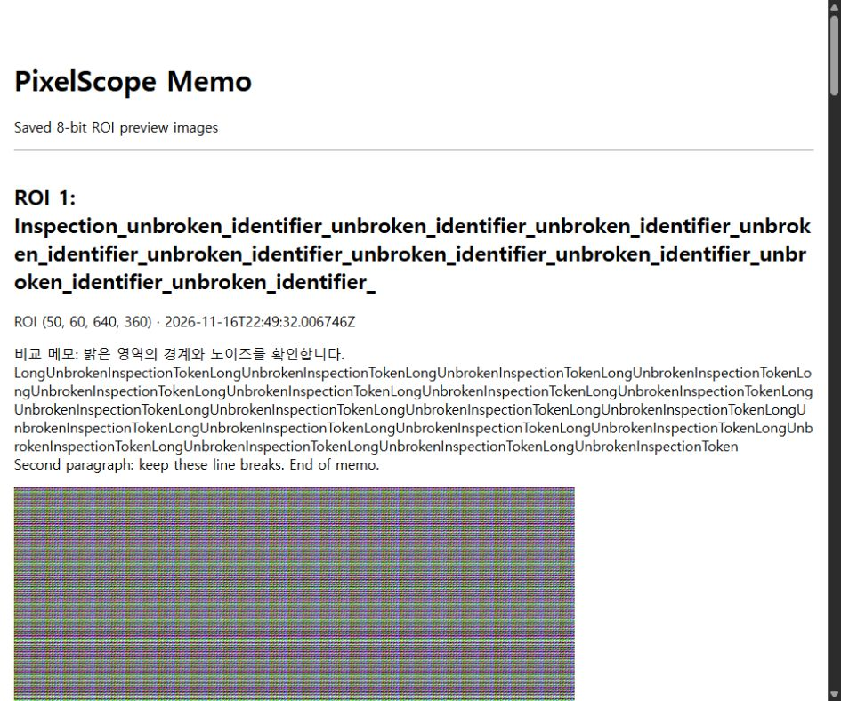
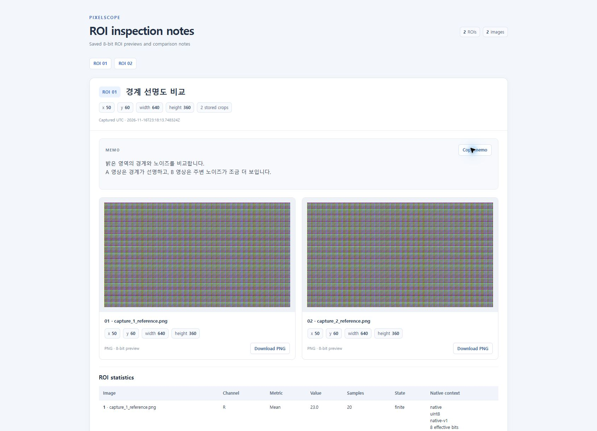
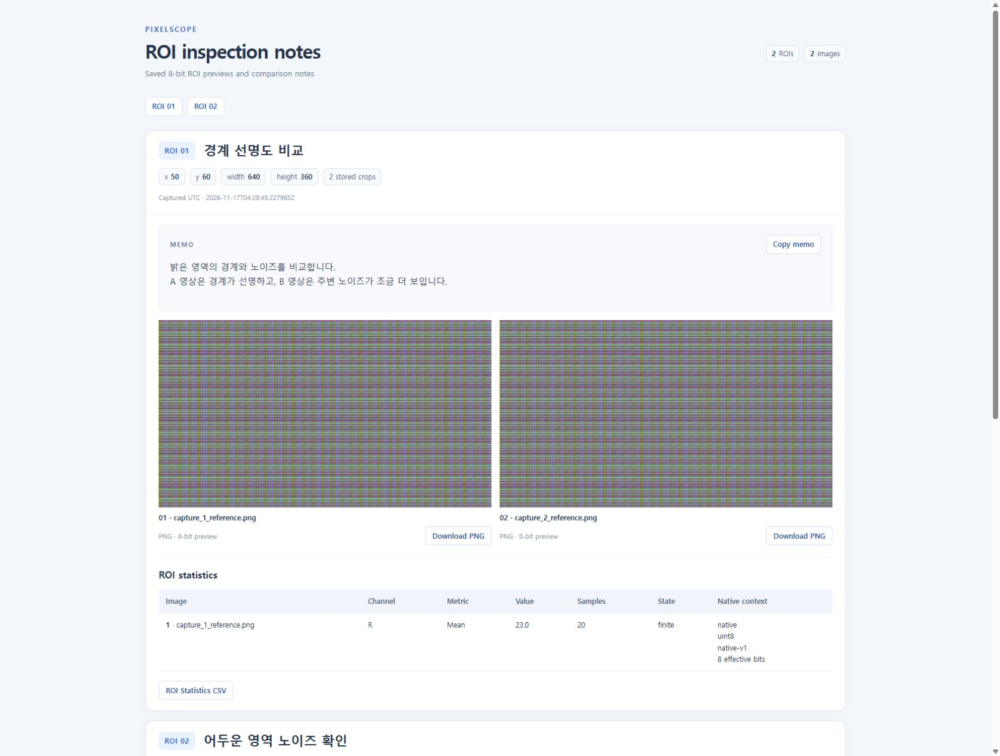

# UI-04 — Memo HTML 긴 문자열 표시

Parent [#230](https://github.com/delphykmc/pixelscope/issues/230),
작업 [#240](https://github.com/delphykmc/pixelscope/issues/240).
[변경 파일·검증 명령·제약](../../exec-plans/active/memo-html-readability.md).

1. **문제:** 실제 Chrome에서 긴 제목·메모·파일명이 오른쪽 화면 밖으로 나갔다.
   1689px viewport에서 document4760px, 메모 client1100px/scroll4465px였다.
2. **수정:** 긴 문자열을 자르지 않고 줄바꿈하고, figure를 보고서 폭 안으로 제한한다.
   메모의 줄바꿈, 이미지 원본 PNG·좌표, CSV·pxmemo map은 바꾸지 않는다.
3. **호환성:** 구형 ZIP의 legacy/v2 HTML 검증 규칙은 고정한다. 새 표시는v3로
   분리했으며, 이전 main에서 생성한 실제 합성 ZIP 두 개를 읽고 변조를 거부하는
   회귀를 포함한다. 새 기능/설정/별도 Export는 추가하지 않았다.
4. **확인:** unit49건11.03초, UI10건14.94초 통과. 최종 소스
   `562244935fe859e23d7f6dcb3a8887940867be20` 독립 리뷰PASS.
   실제 Chrome에서2/4/6-source×2ROI의 crop4/8/12개 모두 로드, CSV링크2개씩 표시.
   기본1689px에서 document1674px, 좁은960px에서945px로 가로 넘침 없음.

## 긴 문자열 조건 전후

Before: merged `e6e2265a`의 production save로 생성한 보고서다.
작은 합성 crop은 텍스트 배치 재현용이며 실제 큰 이미지 확인은 아래 별도 장면이다.
After는 같은 제목/메모/파일명 길이와 작은 crop 조건이며, CSV 링크도 포함한다.

## 큰 crop·좁은 화면

[실제 browser 측정 JSON](checks.json). 모든 입력·Statistics 값은 합성 데이터다.
PNG·브라우저 JPG는 이미지 품질 알고리즘 수용 증거가 아니며, HTTP로 표시한
정적 보고서의 화면 증거다. 직접 file URL 자동화는 보안 정책에 차단되어 중단했다.
허용된 loopback HTTP는 합성 보고서 폴더만 제공했으며 외부에 공개하지 않았다.
파일 직접 열기·CSV 다운로드 UI·물리 DPI·인쇄/PDF·모든 브라우저·신규 full pytest는
미검증이다. 원본 영상·사용자 저장물이나 공식 승인 User Guide PNG는 변경하지 않았다.

## 카드형 보고서와 Stat 표 — 추가 피드백 반영

1. ROI 번호와 제목을 카드 상단에 표시하고 좌표·크기를 배지로 분리했다.
2. 메모는 일반 텍스트와 줄바꿈을 유지하며 Copy memo로 복사한다.
3. 각 그림의 Download PNG는 여백·주석 없는 저장 crop 자체를 내려받는다.
4. 저장된 Stat이 있으면 영상·채널·지표·값·샘플·상태를 표로 표시한다.
   Native context도 함께 남기고 CSV 링크를 유지한다. 새로 계산하지 않는다.

[전체 화면](cards-stat-full.jpg), [긴 텍스트·960px 화면](cards-narrow.jpg),
[브라우저 검증 결과](cards-checks.json). 합성 데이터로 촬영했다.
실제 Chrome Copy 클릭 후 별도 합성 textarea에 Ctrl+V하여 줄바꿈 포함 일치를
확인했다. PNG 다운로드 파일 SHA-256은 저장 crop과 일치했다. 런타임 clipboard
readText는 빈 값이어서 복사 판정에는 실제 붙여넣기를 사용했다.
직접 파일 열기, CSV 버튼 클릭, 인쇄/PDF 및 모든 브라우저는 미검증이다.

## 중복 좌표 제거와 Stat 체크 시점 수정

1. x/y/width/height는 ROI 상단에 한 번만 표시한다.
2. crop별 카드 테두리·배경·중복 배지를 없애고 여백을 줄였다.
3. ROI가 이미 추가된 뒤 Stat을 체크해도 같은 ROI에 통계가 붙는다.
   캡처 도중 체크, 분석 대기 후 완료도 검증한다. 메모·crop은 유지한다.

[좁은 화면](compact-narrow.jpg). 화면은 합성 fixture이며, 실제 앱 저장 경로의
Stat 포함은 별도 Qt workflow 회귀에서 파일 재열기·CSV·HTML 표까지 검증한다.
