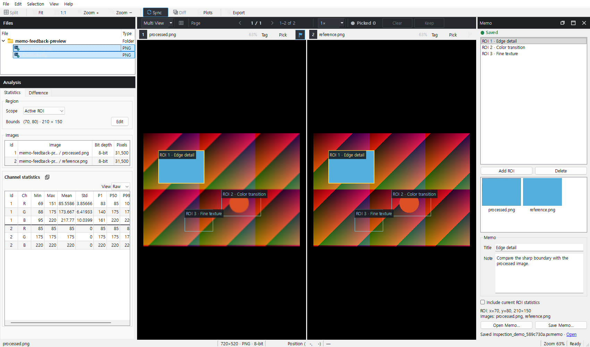
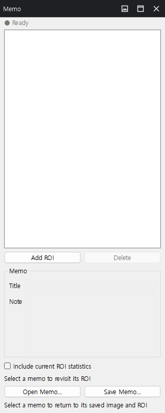
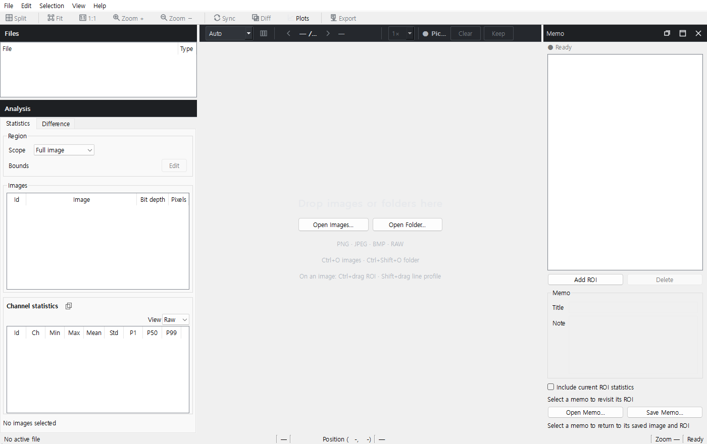
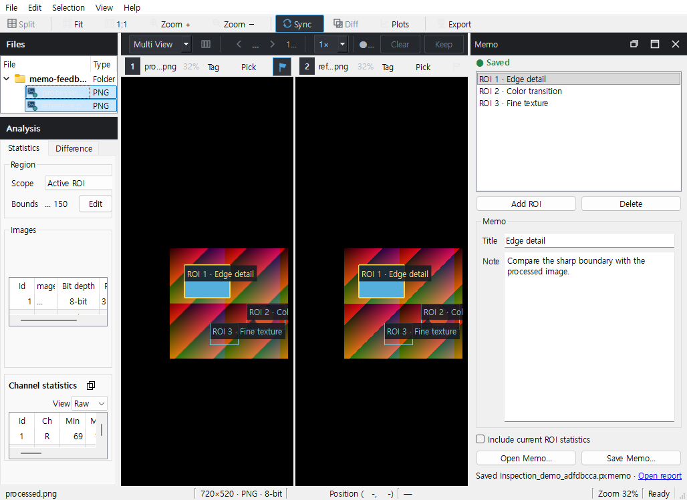
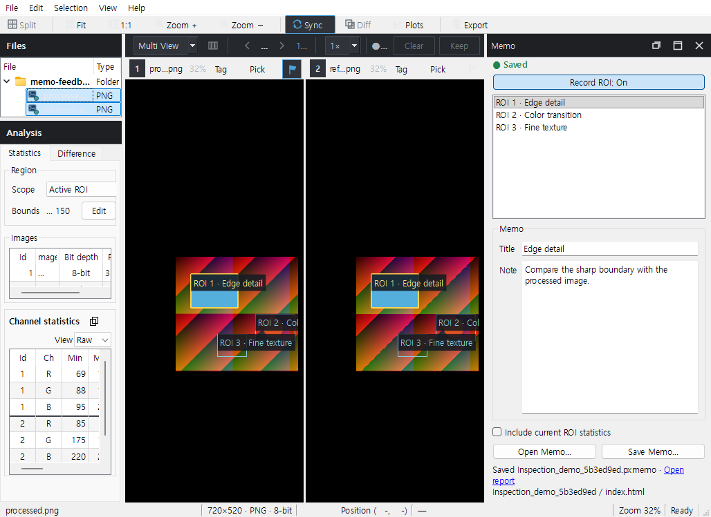
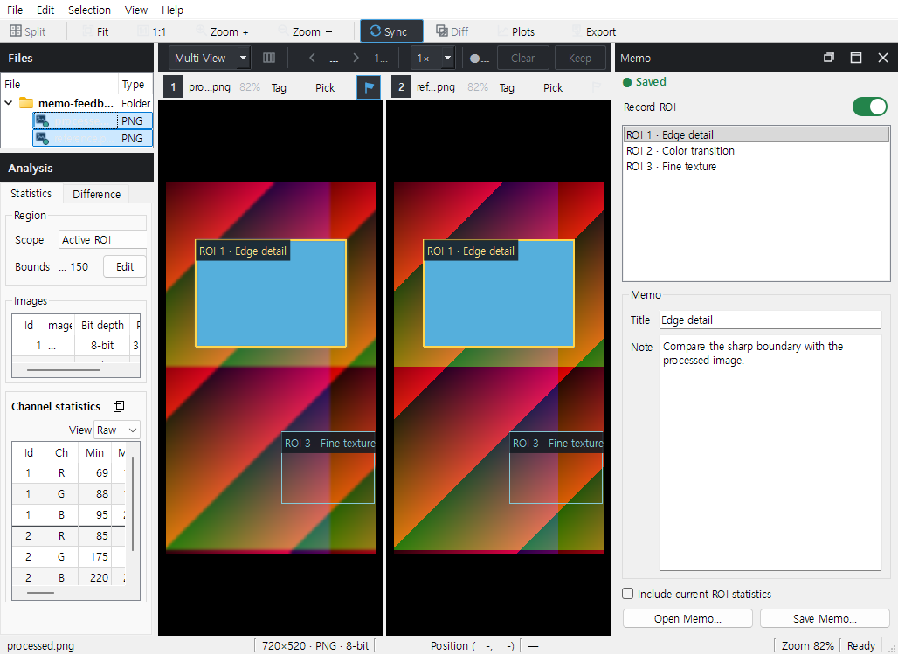

# ROI Memo 간단 가이드

실제 Qt 화면이며 합성 예시 영상을 사용했습니다. 1~5절은 #228까지의 캡처 이력입니다. 6절은 `codex/memo-folder-live-switch-20261112`의 새 폴더 포맷·창 표시 수정이며 아직 MAIN 미병합입니다.

## 1. 메인 화면

1. 기존 Files에서 비교할 영상을 선택합니다. 중복 Workspace/비교 Preset은 제거한 상태입니다.
2. **View → Memo**로 오른쪽 ROI 메모 패널을 엽니다. 별도 모드 전환은 없습니다.

## 2. ROI 단위로 기록

3. **Ctrl+드래그**로 ROI를 그리면 목록에 새 ROI가 추가되고 입력란이 비워집니다. 짧은 crop 캡처가 끝나면 설명을 입력합니다.
4. 다른 ROI를 그리면 새 메모를 시작합니다. 목록의 **ROI 1 / ROI 2**를 누르면 그 ROI와 설명으로 돌아갑니다. 목록은 파일 목록이 아닙니다.
5. 제목·설명은 타이핑하는 즉시 메모리에 반영됩니다. Update 버튼은 없습니다. **Add ROI / Delete**는 목록의 ROI를 추가·삭제합니다.
6. 필요하면 **Include current ROI statistics**로 새 ROI 기록에 현재 표시된 native 통계를 함께 넣습니다.

## 3. Save Memo 한 번

7. 위쪽 **주황색 ● Unsaved**는 아직 메모리에만 있는 변경입니다.
8. **Save Memo…**를 누르면 ROI 메모, PNG crop, 선택한 통계 CSV와 HTML을 한 `.pxmemo` 파일에 보관합니다. 별도 Export 버튼은 없습니다.
9. 저장이 끝나면 **초록색 ● Saved**로 바뀝니다.

10. `.pxmemo`는 ZIP 컨테이너입니다. PixelScope에서 다시 열어 편집하거나, 압축 도구로 사본을 풀어 `index.html`, `images/`, `statistics/`를 보고서에 사용할 수 있습니다. 원본 영상 전체를 넣지는 않습니다.

## 4. 파일 선택이 바뀌면 초기화

11. Files의 선택 영상이나 순서·비교 페이지가 달라지면 현재 ROI 목록과 입력이 초기화됩니다. 미저장 내용은 남지 않습니다. 예전 파일을 다시 선택해도 메모를 자동 검색·매칭하지 않습니다.
12. 과거 기록은 **Open Memo…**로 명시적으로 엽니다. 원본이 없거나 입력 설정이 없어도 저장된 crop과 설명은 읽을 수 있습니다. Memo 안에서 다른 파일을 찾아 선택하는 기능은 없습니다.
13. 앱 종료 시에도 저장하지 않은 메모는 폐기됩니다. 저장 중인 파일 작업은 완료된 뒤 닫습니다.

원본으로 이동하는 연동은 Memo → Viewer 방향만 유지합니다. 저장 crop은 8-bit preview이고, 선택한 CSV 통계는 native 수치입니다. 로컬 기록에는 원본 경로가 포함될 수 있으며 HTML은 자동 원본 경로를 제외합니다.

화면 캡처 실행: **1 passed in 3.38s**. 실제 사용자 수용성과 독립 리뷰는 별도이며, 현재 검증 기록은 [ROI 간소화 계획](../../exec-plans/active/memo-roi-simplification.md)을 참고합니다.

## 5. 모든 ROI 표시와 바로 쓰는 보고서 — 추가 피드백

14. 목록의 ROI가 비교 중인 원본 Viewer에 얇은 네모와 좌상단 번호·제목으로 함께 표시됩니다. 선택한 ROI는 강조합니다. 이 표시는 분석 ROI나 마우스 조작을 바꾸지 않습니다.
15. 저장 창에는 `Memo_원본이름_날짜_시각.pxmemo` 기본 이름을 채웁니다. Save Memo 한 번으로 해당 파일과 같은 이름의 `_report` 폴더를 나란히 만듭니다.
16. 저장 후 패널 하단 **Open report**를 누르면 HTML을 엽니다. `_report/index.html`, `images/`, 선택한 `statistics/`를 그대로 보고서에 사용할 수 있어 압축 해제가 필요하지 않습니다.
17. 보고서 PNG에는 아래처럼 원본 basename과 x/y/width/height를 영상 아래 여백에 적습니다. `.pxmemo` 안에는 정보 여백을 붙이지 않은 crop도 그대로 보관합니다.

기존 보고서 폴더를 직접 편집했거나 다른 파일이 있으면 보호합니다. 이때 `.pxmemo` 저장 성공과 보고서 생성 실패를 구분해 알립니다. 편집한 폴더의 이름을 바꾸거나 다른 곳으로 옮긴 다음 Save Memo를 다시 누르면 보고서를 재생성할 수 있습니다.

최신 구현·검증 범위는 [추가 피드백 계획](../../exec-plans/active/memo-viewer-report-feedback.md)을 참고합니다. 물리 DPI/멀티모니터/SMB/패키지 수용 검증을 대신하는 캡처는 아닙니다.

## 6. 폴더 저장·창 표시·단축키·빠른 ROI 선택

18. Save Memo는 `이름/이름.pxmemo`, `이름/index.html`, `이름/src/` 구조로 저장합니다. `.pxmemo`는 JSON 메타데이터·상대 경로 지도이며, crop/CSV bytes를 넣지 않습니다. 폴더 전체를 함께 옮기면 다시 열 수 있습니다.
19. `src/crops/`는 정보 표기 PNG, `src/originals/`는 정확한 8-bit crop, `src/statistics/`는 선택한 native CSV입니다. HTML은 바로 열거나 하단 Open report로 엽니다. 기존 ZIP은 읽을 수 있고 새 저장 시 기존 파일을 보존합니다.
20. 현재 비교 영상이 메모리에 남아 있고 ID/generation이 일치하면 목록 선택은 ROI·메모만 바꿉니다. 원본 재등록·디코딩·전체 Viewer 재구성을 하지 않습니다. 저장 파일을 열거나 해당 바인딩이 없을 때는 검증 복원을 수행합니다.
21. **Ctrl+Shift+M**으로 Memo를 열거나 숨깁니다. floating 창에서도 동작합니다. 현재 floating/dock 렌더링은 아래와 같습니다.

추가 회귀와 최종 검증은 [폴더·실시간 전환 기록](../../exec-plans/active/memo-folder-live-switch.md)에 남깁니다. 이 캡처가 모든 물리 DPI/OS 환경에서의 기존 표시 문제 원인을 확정하는 것은 아닙니다.

## 7. 간단해진 Memo와 재사용 crop (2026-11-12)

이 절이 위의 과거 footer·originals·미리보기 설명을 대체합니다.

1. ROI를 선택하면 확대율을 유지하면서 Viewer가 해당 위치로 이동합니다.
2. Memo는 목록과 Title/Note 중심입니다. 미리보기와 좌표 요약란은 제거했습니다.
3. `src/crops/` PNG에는 crop 픽셀만 있습니다. 설명과 좌표는 HTML·메타데이터에서 확인합니다.
4. 원본이 없으면 메모는 읽되 Memo 안에 대체 영상을 보여주지 않습니다.
5. 열린 HTML 때문에 폴더 교체가 거부되던 재저장을 수정했습니다. 실제 쓰기 잠금은 해제 후 재시도해야 합니다.

## 8. 명시적인 ROI 기록 (2026-11-12)

1. 창을 열면 **Record ROI: On**입니다. 새 ROI를 그릴 때만 목록에 추가합니다.
2. 버튼을 눌러 **Off**로 바꾸면 메모를 보면서 일반 ROI 분석을 할 수 있습니다.
3. 다시 켜거나 창을 다시 열어도 기존 ROI를 중복 추가하지 않습니다.
4. 목록을 선택하고 **Delete** 키로 삭제합니다. Add/Delete 버튼은 제거했습니다.
5. **Esc**는 분석 ROI와 Memo 선택을 해제하고 대기 중인 Memo 작업을 취소합니다.
   저장하거나 작성한 메모 자체는 남깁니다. Floating 창에서도 같은 Esc 명령을 사용합니다.
6. Esc 후 일반 분석 결과는 갱신될 수 있지만, 취소한 Memo 캡처는 다시 시작하지 않습니다.

## 9. 스위치, ROI 맞춤과 간단한 하단 (2026-11-12)

이 절이 앞선 On/Off 버튼, 센터 이동, 하단 알림·보고서 링크 설명을 대체합니다.

1. Record ROI 스위치로 기록합니다. 선택된 원본이 준비되지 않으면 비활성화됩니다.
2. 목록 선택 시 ROI와 주변 영역이 적당히 보이도록 배율을 자동으로 맞춥니다.
3. Delete는 다음 항목을 선택합니다. Ctrl+A 후 Delete로 전체 삭제할 수 있습니다.
4. 삭제한 노란 분석 박스는 지웁니다. 창을 닫으면 ROI와 메모 박스 표시를 모두 해제하고 기록을 끕니다. 메모 내용은 유지합니다.
5. 하단에는 Open/Save만 남깁니다. 저장 성공 후 HTML이 자동으로 열립니다.
6. 재선택한 ROI의 Statistics·Histogram은 기존 native 캐시를 재사용합니다.

