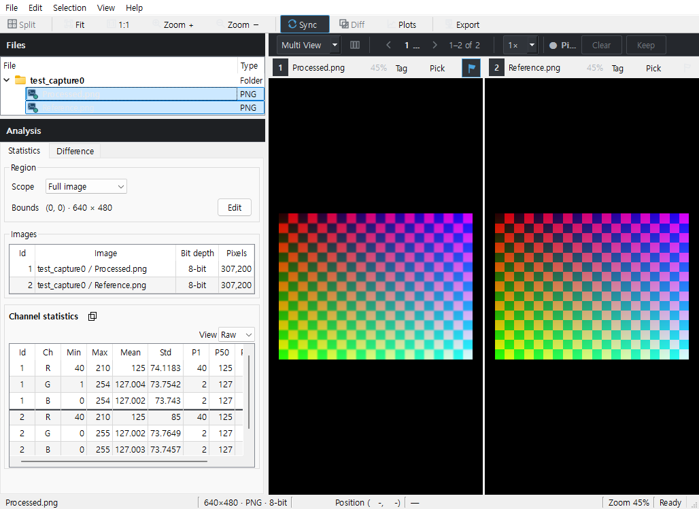
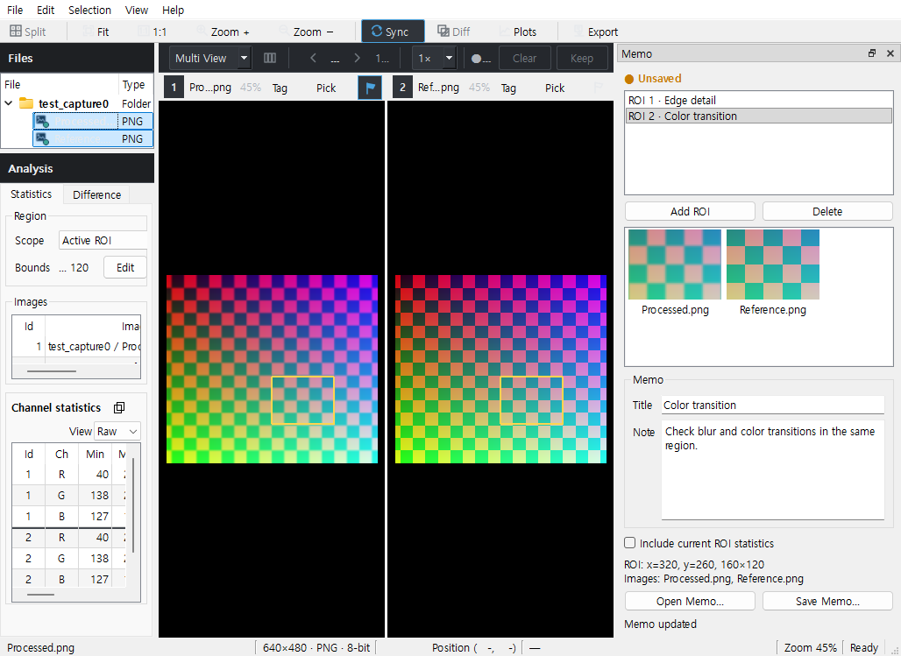
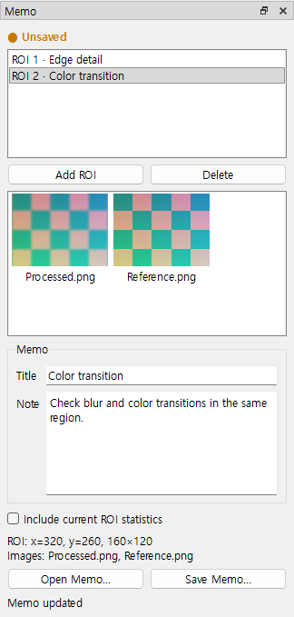
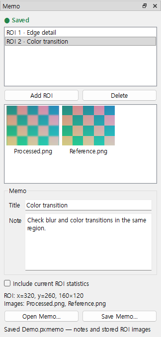
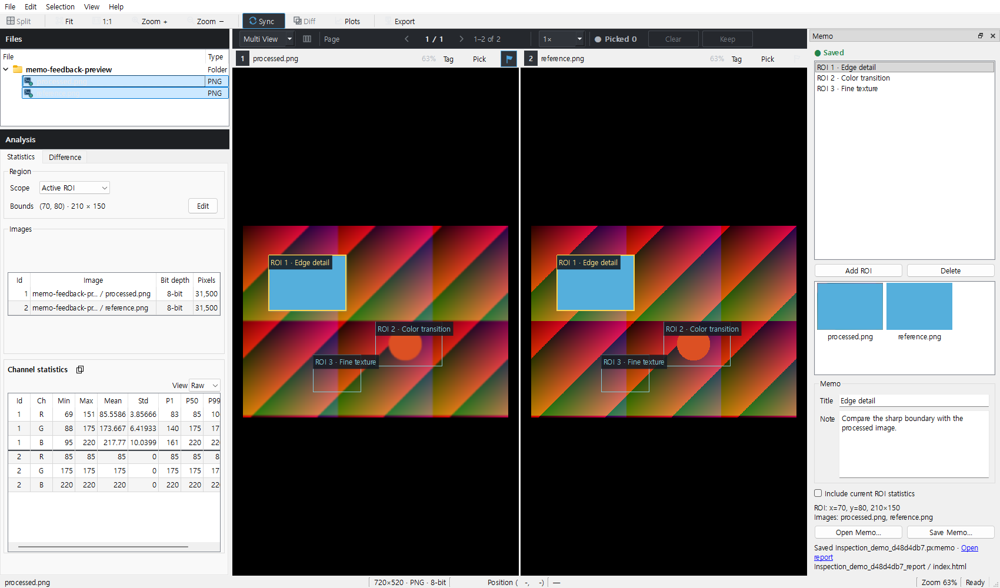
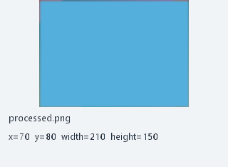

# ROI Memo 간단 가이드

실제 Qt 화면이며 합성 예시 영상 두 장을 사용했습니다. 1~4절의 화면은 이전 ROI 간소화 캡처 이력입니다. 5절은 `codex/memo-viewer-report-20261112`의 추가 피드백 구현이며 아직 MAIN에 병합되지 않았습니다.

## 1. 메인 화면

1. 기존 Files에서 비교할 영상을 선택합니다. 중복 Workspace/비교 Preset은 제거한 상태입니다.
2. **View → Memo**로 오른쪽 ROI 메모 패널을 엽니다. 별도 모드 전환은 없습니다.

## 2. ROI 단위로 기록

3. **Ctrl+드래그**로 ROI를 그리면 목록에 새 ROI가 추가되고 입력란이 비워집니다. 짧은 crop 캡처가 끝나면 설명을 입력합니다.
4. 다른 ROI를 그리면 새 메모를 시작합니다. 목록의 **ROI 1 / ROI 2**를 누르면 그 ROI와 설명으로 돌아갑니다. 목록은 파일 목록이 아닙니다.
5. 제목·설명은 타이핑하는 즉시 메모리에 반영됩니다. Update 버튼은 없습니다. **Add ROI / Delete**는 목록의 ROI를 추가·삭제합니다.
6. 필요하면 **Include current ROI statistics**로 새 ROI 기록에 현재 표시된 native 통계를 함께 넣습니다.

## 3. Save Memo 한 번

7. 위쪽 **주황색 ● Unsaved**는 아직 메모리에만 있는 변경입니다.
8. **Save Memo…**를 누르면 ROI 메모, PNG crop, 선택한 통계 CSV와 HTML을 한 `.pxmemo` 파일에 보관합니다. 별도 Export 버튼은 없습니다.
9. 저장이 끝나면 **초록색 ● Saved**로 바뀝니다.

10. `.pxmemo`는 ZIP 컨테이너입니다. PixelScope에서 다시 열어 편집하거나, 압축 도구로 사본을 풀어 `index.html`, `images/`, `statistics/`를 보고서에 사용할 수 있습니다. 원본 영상 전체를 넣지는 않습니다.

## 4. 파일 선택이 바뀌면 초기화

11. Files의 선택 영상이나 순서·비교 페이지가 달라지면 현재 ROI 목록과 입력이 초기화됩니다. 미저장 내용은 남지 않습니다. 예전 파일을 다시 선택해도 메모를 자동 검색·매칭하지 않습니다.
12. 과거 기록은 **Open Memo…**로 명시적으로 엽니다. 원본이 없거나 입력 설정이 없어도 저장된 crop과 설명은 읽을 수 있습니다. Memo 안에서 다른 파일을 찾아 선택하는 기능은 없습니다.
13. 앱 종료 시에도 저장하지 않은 메모는 폐기됩니다. 저장 중인 파일 작업은 완료된 뒤 닫습니다.

원본으로 이동하는 연동은 Memo → Viewer 방향만 유지합니다. 저장 crop은 8-bit preview이고, 선택한 CSV 통계는 native 수치입니다. 로컬 기록에는 원본 경로가 포함될 수 있으며 HTML은 자동 원본 경로를 제외합니다.

화면 캡처 실행: **1 passed in 3.38s**. 실제 사용자 수용성과 독립 리뷰는 별도이며, 현재 검증 기록은 [ROI 간소화 계획](../../exec-plans/active/memo-roi-simplification.md)을 참고합니다.

## 5. 모든 ROI 표시와 바로 쓰는 보고서 — 추가 피드백

14. 목록의 ROI가 비교 중인 원본 Viewer에 얇은 네모와 좌상단 번호·제목으로 함께 표시됩니다. 선택한 ROI는 강조합니다. 이 표시는 분석 ROI나 마우스 조작을 바꾸지 않습니다.
15. 저장 창에는 `Memo_원본이름_날짜_시각.pxmemo` 기본 이름을 채웁니다. Save Memo 한 번으로 해당 파일과 같은 이름의 `_report` 폴더를 나란히 만듭니다.
16. 저장 후 패널 하단 **Open report**를 누르면 HTML을 엽니다. `_report/index.html`, `images/`, 선택한 `statistics/`를 그대로 보고서에 사용할 수 있어 압축 해제가 필요하지 않습니다.
17. 보고서 PNG에는 아래처럼 원본 basename과 x/y/width/height를 영상 아래 여백에 적습니다. `.pxmemo` 안에는 정보 여백을 붙이지 않은 crop도 그대로 보관합니다.

기존 보고서 폴더를 직접 편집했거나 다른 파일이 있으면 보호합니다. 이때 `.pxmemo` 저장 성공과 보고서 생성 실패를 구분해 알립니다. 편집한 폴더의 이름을 바꾸거나 다른 곳으로 옮긴 다음 Save Memo를 다시 누르면 보고서를 재생성할 수 있습니다.

최신 구현·검증 범위는 [추가 피드백 계획](../../exec-plans/active/memo-viewer-report-feedback.md)을 참고합니다. 물리 DPI/멀티모니터/SMB/패키지 수용 검증을 대신하는 캡처는 아닙니다.
