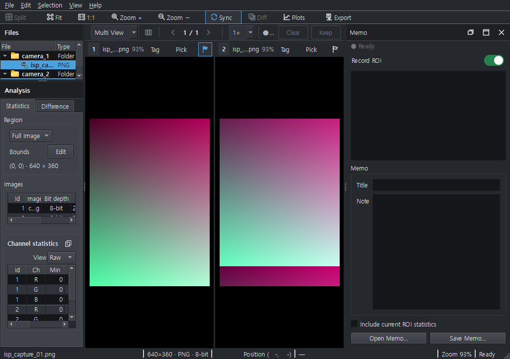

# 실제 화면 기반 순차 UI 검토 — 2026-11-13

Parent: [#230](https://github.com/delphykmc/pixelscope/issues/230).
첫 수정: [UI-01 #231](https://github.com/delphykmc/pixelscope/issues/231).
계약/명령/제약: [실행 기록](../../exec-plans/active/ui-readability-sequential.md).

## 1. 기준과 증거 범위

- Before: merged main `603626d14a479a2a7ad3de74d5b23f57a50abc0c`.
- After: source/test `058aced3e8ef60d9191ca294d9f4788cf6053fea`.
- 실제 production composition과 합성 입력, 격리 QSettings, `QWidget.grab()` PNG다.
  모형 이미지나 이미지 합성이 아니다. 각 PNG 옆 JSON에 source SHA/크기/DPR/해시가 있다.
- Windows/Qt 6.4.2, DPR1, 실제 desktop 가용 영역은 1024×720이다.
  1400×880 및 1680×980은 desktop을 넘는 QWidget 렌더다. 물리 FHD/DPI 검증으로 부르지 않는다.
- Computer Use 연결은 초기화 오류 `os error 3`으로 두 번 실패했다. OS 입력을 통한
  실사용 검증과 이 저장소의 실제 Qt 위젯 하네스 검증을 구분한다.
- 공식 User Guide screenshot manifest의 승인 이미지 교체/자동 승격은 수행하지 않았다.

## 2. 첫 수정: 좁은 Memo 병행 화면의 ROI 범위

동일한 1024×720/DPR1, 두 RGB 원본, Memo dock, sidebar 167px에서 대조했다.

| 항목 | Before | After |
|---|---|---|
| Sidebar 폭 | 167px | 167px 유지 |
| 범위 요약 폭 | 36px | 129px |
| 표시 문자열 | `… 360` | `(0, 0) · 640 × 360` |
| Scope | 부모 밖으로 잘리거나 값 일부가 생략됨 | 제목을 접고 선택 값을 표시 |
| 넓은 1400px 화면 | 두 줄, 요약 98px | 두 줄/98px 유지 |

좁을 때만 범위를 Bounds/Edit 아래의 전체 폭 줄로 옮긴다. 넓어지면 기존 배치가
돌아온다. Scope의 접근성 이름은 유지하며, 패널 최소폭·새 모드·설정은 추가하지 않았다.
원본 배열/generation, ROI, 분석 요청 identity는 재배치로 바뀌지 않는다.
한 줄이 물리적으로 들어갈 수 없는 극도로 좁은 폭에서는 tooltip/접근성 전체 값이 남는다.

### Before

### After

## 3. 캡처 목록과 판정

| ID | 화면 | 판정 |
|---|---|---|
| A01 | [빈 1024px](baseline/empty-narrow.png) | 기준 캡처, 이번 수정 없음 |
| A02 | [두 장 1024px](baseline/compare-narrow.png) / [After](after/compare-narrow.png) | Memo 없는 390px sidebar는 기존 배치 유지 |
| A03 | [두 장 1400px](baseline/compare-default.png) | 기존 가독성 기준, 물리 화면 증거 아님 |
| A04 | [Memo 1024px](baseline/memo-narrow.png) / [After](after/memo-narrow.png) | UI-01 재현/수정 |
| A05 | [Memo 1400px](baseline/memo-default.png) / [After](after/memo-default.png) | 넓은 배치 복귀 확인 |
| A06 | [기본 개요](baseline/window_overview.png) | 1680px 렌더, 기준 캡처 |
| A07 | [Statistics](baseline/statistics_workspace.png) | 가로 스크롤을 결함으로 단정하지 않음 |
| A08 | [6장 비교](baseline/six_image_multiview.png) | 긴/동일 basename 원본 식별은 별도 후속 입력 필요 |
| A09 | [Difference](baseline/difference_analysis.png) | 현재 배치/수치 표시 관찰, 변경 없음 |
| A10 | [Histogram dock](baseline/histogram_docked.png) | 통계 행 공간 후보, 임의 preset을 만들지 않음 |
| A11 | [Plots float](baseline/plots_floating.png) | 현재 Qt 렌더 관찰; 물리 OS/DPI 수용은 미검증 |

## 4. 다음 항목

1. 긴/동일 파일명으로 Files·tile·분석 표의 구별 가능성을 확인한다. 짧은 합성 이름만으로
   모든 source 식별 문제가 해결됐다고 판정하지 않는다.
2. Memo float 및 긴/겹치는 ROI label을 검토한다. 현재 Plots float 캡처가 Memo float를
   대신하지 않는다.
3. 생성 HTML을 실제 브라우저에서 열어 긴 메모·2/4/6 crop·CSV 표시를 검토한다.
   테스트의 `openUrl` 호출 성공을 브라우저 렌더 수용으로 간주하지 않는다.
4. 필요가 입증된 항목만 다음 작은 수정으로 진행한다. Workspace/Profile/preset,
   별도 Export와 Memo 파일 매칭은 현재 범위에 넣지 않는다.

## 5. 재현 방법

기준 6장: 기존 `scripts/capture_ui_scene.py --scene <scenario> --output <PNG>
--metadata <JSON> --source-sha <baseline SHA>`를 각각 별도 프로세스로 실행했다.
scenario는 window_overview/statistics_workspace/six_image_multiview/
difference_analysis/histogram_docked/plots_floating이다.

좁은/기본 matrix는 임시 `temp/capture_readability_matrix.py`에서 동일한
`_populated_window`/`_wait_until_ready`와 review_document 합성 입력을 재사용하고
1024×720 또는 1400×880으로 고정해 캡처했다. Memo 없는 경우와 `.show()`한 경우를
각각 기록했다. 임시 도구를 새 영구 UI 아키텍처/대체 capture manifest로 추가하지 않았다.
82건 회귀 명령과 RED→PASS 근거는 실행 기록에 있다. 이 캡처들은 새 full-suite PASS를
의미하지 않으며 자동 병합이나 절전을 예약하지 않았다.
