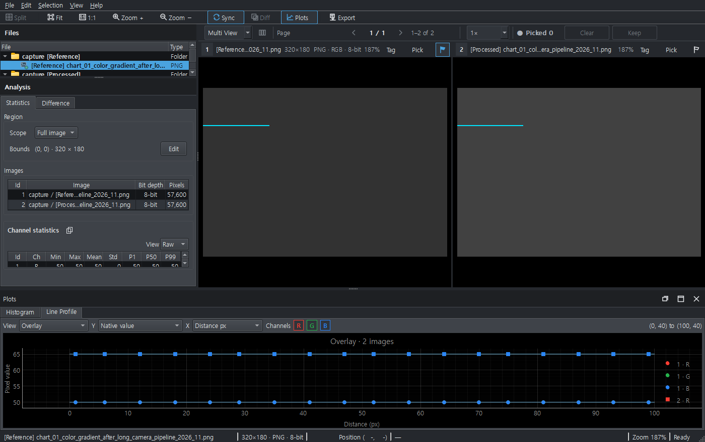

# UI-02 — 긴 동일 파일명과 분석 이름 표시

Parent [#230](https://github.com/delphykmc/pixelscope/issues/230),
항목 [#233](https://github.com/delphykmc/pixelscope/issues/233).
[실행 기록·변경 파일·명령](../../exec-plans/active/ui-source-labels.md).

## 1. 확인한 문제와 수정

같은 긴 파일명이 서로 다른 run/capture 폴더에 있는 경우, 기존 alias resolver는
Files/Viewer에 이미 구분되는 이름을 제공한다. 분석 표와 그래프가 그 앞에 leaf
폴더를 한 번 더 붙여 중요한 run 이름이나 태그를 뒤로 밀고 있었다.

| 입력 | Before 분석 표시 | After 분석 표시 |
|---|---|---|
| 중복 파일명 | `capture / reference_run / capture / chart_…png` | `reference_run / capture / chart_…png` |
| 명시적 태그 | `capture / [Reference] chart_…png` | `[Reference] chart_…png` |
| 별칭 없는 독립 위젯 | `folder / chart.png` | 기존 fallback 유지 |

공통 Qt-free 표시 helper로 기존 별칭을 유지한다. 새 이름 매칭이나 원본 이름 변경은
없으며 원본 ID/배열/generation, 계산 결과·요청/cache, Line reference 선택을 유지한다.
태그를 설정하거나 지워도 다시 계산하지 않고 표시만 갱신하는 회귀를 확인했다.

## 2. 실제 전후 캡처

Before 소스는 UI-01 Draft #232의 `3d8dc8feb75623265740e2dd14ec69a41cd2bdfb`,
After 소스/테스트는 `6f83fdbba0d0d38711b6aa51b59dc753b4e5ef6f`다.
각 PNG 옆 JSON에 source SHA, 실제 위젯 크기, 화면 크기, DPR, PNG 해시와
canonical/Files/Viewer/Statistics/Histogram/Line의 실제 문자열이 있다.

1. 두 장, 같은 긴 basename·같은 leaf 폴더명:
   [Before](before/two-default.png) / [After](after/two-default.png).
2. 네 장, 1024×720의 좁은 화면:
   [Before](before/four-narrow.png) / [After](after/four-narrow.png).
3. Reference/Processed 태그:
   [Before](before/two-tagged.png) / [After](after/two-tagged.png).
4. 수정 후 [Histogram 실제 제목](after/two-histogram.png).
5. 수정 후 [Line Profile 이미지별 실제 제목](after/two-separate-line.png).

### 태그 Before

### 태그 After

처음 세 쌍은 같은 하네스/조건의 전후 캡처이며 추가 두 장은 수정 후 그래프 탭을
직접 보인 것이다. 전후 기본 캡처는 Line Overlay 탭이므로 Histogram 제목은 JSON과
회귀 테스트로 확인하고, 추가 Histogram 캡처를 별도로 남겼다.

## 3. 증거의 한계

Production Qt composition, 합성 RGB 배열, 격리 QSettings, 실제 QWidget.grab을 사용했다.
실제 desktop 가용 영역은 1024×720/DPR1이다. 1400×880 캡처는 desktop을 넘는
QWidget 렌더이며 실제 FHD·물리 DPI·OS 키보드/마우스 수용 증거로 부르지 않는다.
입력은 품질 평가용 알고리즘 결과가 아니라 표시 재현용 상수 영상이다.

매우 좁은 4/6 tile에서는 긴 이름이 여전히 생략될 수 있다. 이번 수정은 중복
접두어를 제거하는 범위이며 모든 화면 폭에서 전체 파일명을 보여준다는 약속은 아니다.
승인된 canonical User Guide PNG는 교체하지 않았다. 임시 캡처 코드는 ignored
temp/capture_source_labels.py이며 새 영구 capture 시스템은 추가하지 않았다.

## 4. 검증과 다음 순서

원래 weak contains 검사를 equality로 강화하여 실패를 재현한 뒤 수정했다.
2026-11-14 재개 후 관련 67건이 22.44초에 통과했다. 기존 태그 해제, 페이지 이동,
Line/Difference reference/cache, YUV, 분석 토큰·요청 및 UI-01 회귀를 포함한다.
신규 full pytest는 미실행이며 UI-01이나 #229의 결과를 이 수정의 전체 PASS로 쓰지 않는다.

다음 후보는 #230에서 Memo float/긴 ROI label, HTML 실제 브라우저 검토를 각각
근거로 확인한다. 추가적인 이름 매칭·새 표시 모드·별도 Export는 이 항목에 넣지 않는다.
